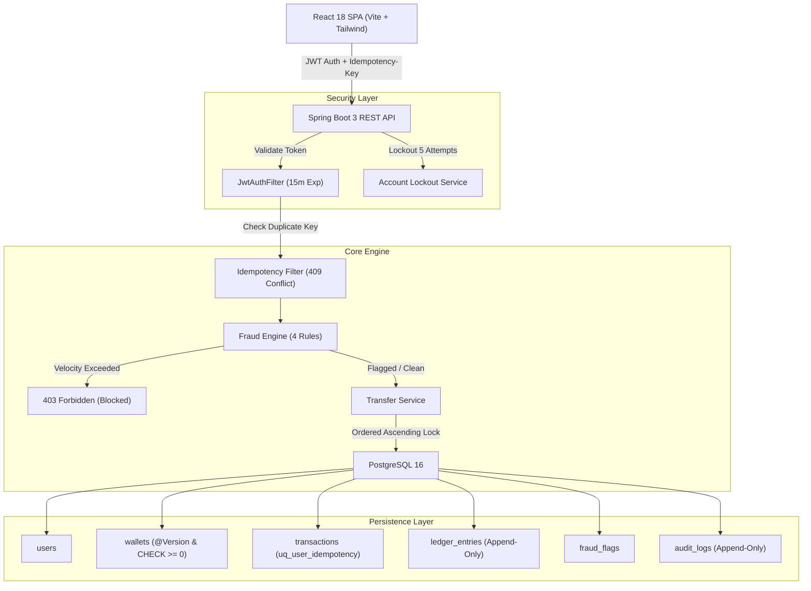

# Secure Payments Ledger & Dashboard

[](https://github.com/yourname/secure-payments-ledger/actions)
[](https://github.com/yourname/secure-payments-ledger)
[](https://spring.io/projects/spring-boot)
[](https://react.dev)
[](https://tailwindcss.com)

A production-grade, concurrency-safe financial payments ledger and modern web dashboard. Built with a **Spring Boot 3 REST API** backend and a **React + Tailwind CSS** frontend. The system provides atomic money transfers with double-entry append-only audit records, pessimistic database locks, idempotency guarantees, and automated real-time fraud heuristics.

> **DEMO SYSTEM NOTICE:** This project is for demonstration and audit simulation purposes only. All currency values are fake and simulated.

> **Current QA status: INCOMPLETE.** See the [quality assurance report](./QUALITY-ASSURANCE-REPORT-2026-10-18.md) for verified results, security findings, and blockers.

---

## 1. System Architecture



---

---

## 2. Configuration & Running Locally

### A. Two Operating Modes (Transparent Separation)
The application provides two clearly defined and isolated modes:
1. **Fictional Demo Mode (In-Browser Simulation):**
   - **Default when no backend URL is deployed or server is unavailable.**
   - All wallets, transfers, idempotency validations, and fraud heuristics run in client-side storage.
   - Every transaction, balance card, and report is explicitly marked with a **"Fictional Demo Data"** badge.
   - Does not fabricate successful backend network calls or pretend data originated from the server.
2. **Live Spring Boot REST API Mode:**
   - Directly dispatches HTTP requests to your Java Spring Boot backend (`${VITE_API_BASE_URL}`).
   - Transmits real `Authorization: Bearer <token>` and `Idempotency-Key` headers.
   - Propagates real HTTP status codes (`400`, `401`, `403`, `409`, `500`).
   - If the backend is offline or unreachable, reports a clear `Backend Server Unreachable` error with a 1-click option to test connectivity or switch to Demo Mode.

---

### B. Configuring the Backend URL

#### Method 1: In the Running Application (Instant UI Configuration)
Click the **Connection Status Pill** in the top navigation bar or the **Settings** button in the top banner. You can:
- Enter your deployed backend URL (e.g. `https://api.yourdomain.com/api/v1` or `http://localhost:8080/api/v1`).
- Click **"Test Connection"** to verify reachability and CORS compatibility.
- Toggle between **Live API Mode** and **Fictional Demo Mode**.

#### Method 2: Via Environment Variables
Copy `.env.example` to `.env` in the project root:
```bash
cp .env.example .env
```
Set `VITE_API_BASE_URL` to your Spring Boot REST API base endpoint:
```env
VITE_API_BASE_URL="http://localhost:8080/api/v1"
```
Rebuild or restart Vite (`npm run dev`).

---

### C. Running Both Applications Locally

#### Terminal 1: Run Spring Boot REST API (Port 8080)
Ensure you have Java 17 and Maven installed, or use Docker:
```bash
# Option 1: Run with Docker Compose (PostgreSQL 16 + Spring Boot)
# PowerShell: provide a stable local database password and generate a JWT key.
$env:POSTGRES_PASSWORD = Read-Host "Choose a local PostgreSQL password"
$env:JWT_SECRET_KEY = (node -p "require('crypto').randomBytes(32).toString('base64')").Trim()
docker compose -f backend/docker-compose.yml up --build

# Option 2: Run Spring Boot with local PostgreSQL
Set-Location backend
$env:SPRING_DATASOURCE_URL = "jdbc:postgresql://localhost:5432/ledger_db"
$env:SPRING_DATASOURCE_USERNAME = "postgres"
$env:SPRING_DATASOURCE_PASSWORD = Read-Host "PostgreSQL password"
$env:JWT_SECRET_KEY = (node -p "require('crypto').randomBytes(32).toString('base64')").Trim()
mvn spring-boot:run
```
Use the same PostgreSQL password each time you reconnect to an existing Compose volume. Keep passwords and generated JWT keys out of source control. To allow a deployed frontend, set `APP_CORS_ALLOWED_ORIGIN_PATTERNS` to a comma-separated list of its exact origins. Local defaults allow only `http://localhost:3000` and `http://127.0.0.1:3000`.
Once started:
- API Base: `http://localhost:8080/api/v1`
- Swagger UI: `http://localhost:8080/swagger-ui.html`
- Health check: `http://localhost:8080/actuator/health`

#### Terminal 2: Run React Frontend Dashboard (Port 3000)
```bash
npm install
npm run dev
```
Open **[http://localhost:3000](http://localhost:3000)** in your browser.

#### CORS Configuration
The Spring Boot backend includes CORS configuration in `backend/src/main/java/com/yourname/ledger/common/config/SecurityConfig.java`:
```java
CorsConfiguration configuration = new CorsConfiguration();
configuration.setAllowedOriginPatterns(List.of("http://localhost:3000", "http://127.0.0.1:3000"));
configuration.setAllowedMethods(Arrays.asList("GET", "POST", "PUT", "DELETE", "OPTIONS"));
configuration.setAllowedHeaders(Arrays.asList("Authorization", "Content-Type", "Idempotency-Key", "X-Requested-With"));
```
Origins are configured with `APP_CORS_ALLOWED_ORIGIN_PATTERNS`. Credentialed cross-origin cookies are disabled; the API uses bearer-token authorization.

---

## 3. Backend REST API Endpoints

Base URL: `${VITE_API_BASE_URL}` (default: `http://localhost:8080/api/v1`)
Swagger UI: `http://localhost:8080/swagger-ui.html` | OpenAPI Docs: `http://localhost:8080/v3/api-docs`

| Method | Endpoint | Role | Description |
|---|---|---|---|
| `POST` | `/api/v1/auth/register` | Public | Register user (`email`, `password`) |
| `POST` | `/api/v1/auth/login` | Public | Authenticate user -> returns `{ token }` |
| `POST` | `/api/v1/wallets` | Authenticated | Create isolated demo wallet for current user |
| `GET` | `/api/v1/wallets/me` | Authenticated | Fetch authenticated user's wallet |
| `GET` | `/api/v1/wallets/{id}` | Owner | Fetch wallet details (`balanceMinor`, `currency`) |
| `POST` | `/api/v1/wallets/{id}/topup` | Owner | Simulated deposit (`amountMinor`) -> Credit ledger |
| `POST` | `/api/v1/transfers` | Owner | Execute atomic transfer (`fromWalletId`, `toWalletId`, `amountMinor`) with `Idempotency-Key` header |
| `GET` | `/api/v1/transactions` | Authenticated | Query transaction history for logged-in user or wallet |
| `GET` | `/api/v1/reports/daily?date=YYYY-MM-DD` | ADMIN | Daily transaction volume, success/failure rate & counts |
| `GET` | `/api/v1/reports/fraud-summary` | ADMIN | Fraud flag trigger aggregation per rule |

> **Backend Note:** The endpoint `GET /api/v1/transactions` was added to the Spring Boot controller to allow paginated, filtered transaction history queries by user.

---

## 4. Key Design Decisions

### A. Strict Integer Money Handling (Paise)
- Floating-point arithmetic (`0.1 + 0.2 = 0.30000000000000004`) is strictly forbidden for all balances and database rows.
- All amounts are stored and communicated as **integers in minor units (paise)**:
  - 1 Rupee = 100 paise.
  - `25000` minor units = `₹250.00`.
- The frontend utility `toMinorUnits()` uses decimal splitting rather than floating-point multiplication, guaranteeing zero rounding errors.

### B. Idempotency-Key Protocol
1. When the Transfer page loads, a UUID v4 key is generated client-side.
2. The key is attached to the request via the `Idempotency-Key` HTTP header.
3. If network fails or user double-clicks, the **exact same key** is sent:
   - If payload is identical: Backend returns the previous transaction result with no double debit.
   - If payload differs: Backend returns **`409 Conflict`**.
4. A new idempotency key is generated only after a successful transfer or when the user edits form inputs.

### C. Concurrency Safety & Deadlock Prevention
- Both sender and recipient wallets are locked in a single transaction using **ordered pessimistic write locks**:
  ```java
  @Lock(LockModeType.PESSIMISTIC_WRITE)
  @Query("select w from Wallet w where w.id in :ids order by w.id")
  List<Wallet> lockAllByIdOrdered(@Param("ids") List<Long> ids);
  ```
- Because wallets are locked strictly in ascending ID order, cyclic deadlock conditions between simultaneous inverse transfers ($A \rightarrow B$ and $B \rightarrow A$) are mathematically impossible.
- An optimistic `@Version` column and database `CHECK (balance_minor >= 0)` constraint serve as additional defense-in-depth safety nets.

### D. Automated Rule-Based Fraud Engine
Before debiting, transfers pass through the automated `FraudEngine`:
1. **Velocity Rule:** $> 5$ transfers in 60 seconds $\rightarrow$ **BLOCKED (HTTP 403 Forbidden)**.
2. **High Amount Rule:** $> 5,000,000$ minor units (₹50,000) $\rightarrow$ **FLAGGED** for audit review.
3. **Unusual Amount Rule:** $> 5\times$ user's historical average of last 10 transfers $\rightarrow$ **FLAGGED**.
4. **New Wallet Risk:** Wallet created $< 24$ hours ago sending $> ₹20,000 \rightarrow$ **FLAGGED**.

---

## 5. Security & OWASP Top 10 Mapping

| OWASP Risk | Mitigation in secure-payments-ledger |
|---|---|
| **A01: Broken Access Control** | Ownership checks verified in service layer before fetching or mutating wallets (`fromWallet.userId == auth.userId`). Admin report routes protected by `hasRole('ADMIN')`. |
| **A02: Cryptographic Failures** | Passwords hashed using BCrypt (work factor 10). JWT signed with 256-bit HMAC key loaded from environment variables. |
| **A03: Injection** | Spring Data JPA / Hibernate parameterized queries prevent SQL injection. React JSX auto-escapes text preventing XSS. |
| **A04: Insecure Design** | Rate limiting / Account Lockout (5 failed logins locks account for 5 minutes). Idempotency keys prevent double debits. |
| **A05: Security Misconfiguration** | CORS origins restricted. Secrets never hardcoded; loaded via `.env` / environment variables. |
| **A07: Identification & Auth** | Short-lived 15-minute JWT tokens. 401 interceptor purges credentials on expiry. |
| **A09: Logging & Monitoring** | Append-only `audit_logs` table (no update or delete methods in repository). No sensitive tokens or passwords logged. |

> **Production Storage Note:** For production deployments, storing JWTs in **httpOnly, Secure, SameSite=Strict cookies** is recommended over sessionStorage to protect against XSS token exfiltration.

---

## 6. Testing Strategy

### Frontend Testing (Vitest & React Testing Library)
Run test suite:
```bash
npm run test
```
Covered test suites:
- `money.test.ts`: Verifies minor unit conversions, Indian numbering system, and floating point `0.1 + 0.2` rounding edge cases.
- `StatusBadge.test.tsx`: Validates label rendering and exact color classes for `SUCCESS`, `FAILED`, `FLAGGED`, and `BLOCKED`.
- `authAndRoute.test.tsx`: Validates email and 8-character password checks, and verifies `ProtectedRoute` redirects unauthorized requests.
- `transfer.test.ts`: Verifies Idempotency-Key preservation across retries, 409 conflict detection, and 403 velocity rule blocking.

### Backend Testing (JUnit 5, Mockito & Testcontainers)
```bash
cd backend
mvn clean test
```
- Minimum **80% line coverage** enforced via JaCoCo maven plugin.

---

## 7. Sample cURL Commands

```bash
# 1. Register User
curl -X POST http://localhost:8080/api/v1/auth/register \
  -H "Content-Type: application/json" \
  -d '{"email": "alex@ledger.com", "password": "Password123!"}'

# 2. Login
curl -X POST http://localhost:8080/api/v1/auth/login \
  -H "Content-Type: application/json" \
  -d '{"email": "alex@ledger.com", "password": "Password123!"}'

# 3. Create Wallet
curl -X POST http://localhost:8080/api/v1/wallets \
  -H "Authorization: Bearer <TOKEN>"

# 4. Top Up Wallet (₹500.00 = 50,000 paise)
curl -X POST http://localhost:8080/api/v1/wallets/101/topup \
  -H "Authorization: Bearer <TOKEN>" \
  -H "Content-Type: application/json" \
  -d '{"amountMinor": 50000}'

# 5. Idempotent Transfer (₹100.00 = 10,000 paise)
curl -X POST http://localhost:8080/api/v1/transfers \
  -H "Authorization: Bearer <TOKEN>" \
  -H "Idempotency-Key: e4b256be-4c4f-4d2b-a01b-9801bf7b1298" \
  -H "Content-Type: application/json" \
  -d '{"fromWalletId": 101, "toWalletId": 102, "amountMinor": 10000}'

# 6. Admin Daily Report
curl -X GET "http://localhost:8080/api/v1/reports/daily?date=2026-10-17" \
  -H "Authorization: Bearer <ADMIN_TOKEN>"
```

---

## 8. Deployment (Vercel / Netlify)

1. Deploy the frontend repository to Vercel or Netlify.
2. Add environment variable:
   - `VITE_API_BASE_URL`: `https://your-api-domain.com/api/v1`
3. `vercel.json` is pre-configured with SPA rewrites to `/index.html`.
4. Ensure your Spring Boot backend's CORS configuration allows only your deployed frontend domain.

---

## 9. Limitations & Future Roadmap
- **Kafka Event Streaming:** Publish transaction ledger events to Apache Kafka topics for asynchronous fraud analytics and ledger replication.
- **Distributed Rate Limiting:** Implement Redis-backed token bucket rate limiters for cluster deployments.
- **Multi-Currency FX Ledger:** Add real-time foreign exchange conversion rates with currency precision tables.
